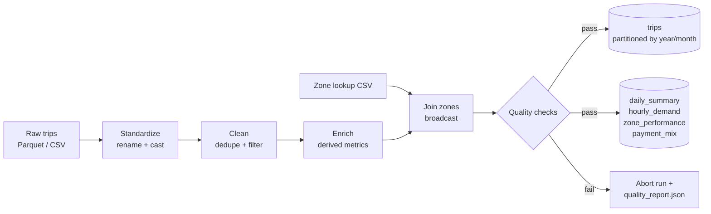

# NYC Taxi Batch Pipeline with PySpark

[](https://github.com/kaajjalchoudhary/Data-Engineering/actions/workflows/ci.yml)


A batch ETL pipeline that turns raw [NYC TLC yellow-taxi trip records](https://www.nyc.gov/site/tlc/about/tlc-trip-record-data.page)
into a clean, partitioned trip table plus analytics-ready aggregates. Every run is gated by
data quality checks, so bad data never reaches the curated layer.

## Architecture



| Stage | What it does |
|---|---|
| **Extract** | Reads TLC Parquet (or CSV) and the taxi zone lookup table |
| **Standardize** | Maps raw columns to snake_case with explicit types; tolerant of schema drift between years (e.g. `Airport_fee` vs `airport_fee`, missing columns) |
| **Clean** | Removes exact duplicates, null keys, negative fares, zero/absurd distances, trips longer than 4h, impossible speeds (>100 mph) and pickups outside the reporting period |
| **Enrich** | Adds a SHA-256 `trip_id`, trip duration, average speed, tip %, calendar attributes, time-of-day bucket and payment description |
| **Join** | Broadcast-joins pickup and dropoff borough/zone names |
| **Quality gate** | Not-empty, not-null, uniqueness and range checks; error-level failures stop the run before anything is written |
| **Load** | Writes the trip fact table partitioned by `pickup_year/pickup_month` (dynamic partition overwrite, so reruns are idempotent) and four aggregate tables |

## Outputs

| Table | Grain | Example questions |
|---|---|---|
| `trips` | one row per trip | Detailed analysis, downstream modelling |
| `daily_summary` | day | How do trip volume and revenue trend over the month? |
| `hourly_demand` | day of week × hour | When is demand highest? |
| `zone_performance` | pickup zone | Which zones generate the most revenue? |
| `payment_mix` | payment type | What share of trips are paid by card vs cash? |

## Quick start

Requires Python 3.9+ and Java 17 (for Spark).

```bash
git clone https://github.com/kaajjalchoudhary/Data-Engineering.git
cd Data-Engineering
python -m venv .venv && source .venv/bin/activate
make install

# Run on a generated sample (no download needed)
make sample run

# Or run on a real month of TLC data (~3M trips)
make download MONTH=2024-01
make run-real MONTH=2024-01
```

Inspect the results:

```python
from pyspark.sql import SparkSession
spark = SparkSession.builder.getOrCreate()
spark.read.parquet("data/curated/sample/daily_summary").show()
```

## Testing

```bash
make test   # unit tests for every transformation + an end-to-end pipeline test
make lint   # ruff
```

CI runs linting, the test suite and a full pipeline run on sample data for every push.

## Project structure

```
├── src/taxi_pipeline/
│   ├── main.py            # CLI entry point and orchestration
│   ├── extract.py         # readers for trips and zone lookup
│   ├── schema.py          # raw → clean column mapping
│   ├── transform.py       # standardize, clean, enrich, add_zones
│   ├── aggregates.py      # analytics tables
│   ├── quality.py         # data quality checks
│   ├── load.py            # parquet + quality report writers
│   ├── sample_data.py     # synthetic data generator (with deliberate bad rows)
│   └── spark_session.py
├── tests/                 # pytest suite (local Spark)
├── scripts/download_tlc_data.sh
├── .github/workflows/ci.yml
└── Makefile
```

## Design notes

- **Schema drift**: TLC files change column names and types across years, so standardization matches
  columns case-insensitively and fills missing ones with typed nulls instead of failing.
- **Idempotent loads**: `partitionOverwriteMode=dynamic` means reprocessing one month only replaces that
  month's partition.
- **Small-table joins**: the 265-row zone lookup is broadcast to avoid shuffling the trip table.
- **Fail fast**: quality checks run on the cached DataFrame before any write, and the results are saved
  to `quality_report.json` for every run.

## Possible next steps

- Orchestrate monthly runs with Airflow
- Write to Delta Lake / Iceberg for ACID upserts and time travel
- Run on a cluster (EMR / Dataproc / Databricks) against the full multi-year history
